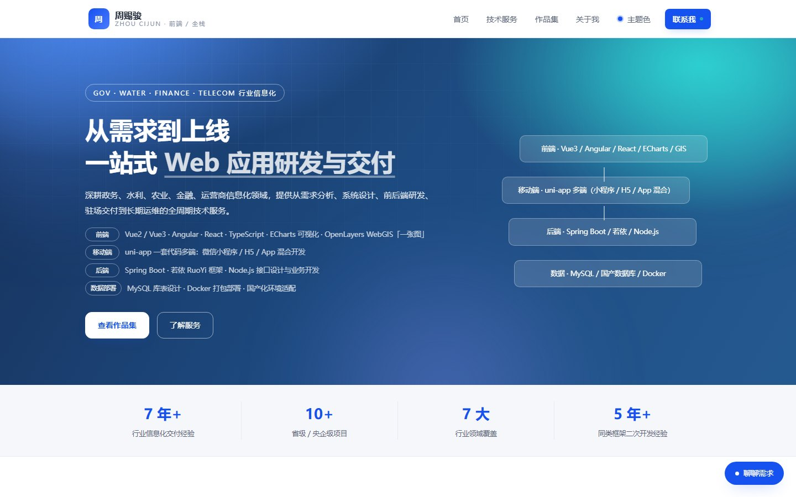
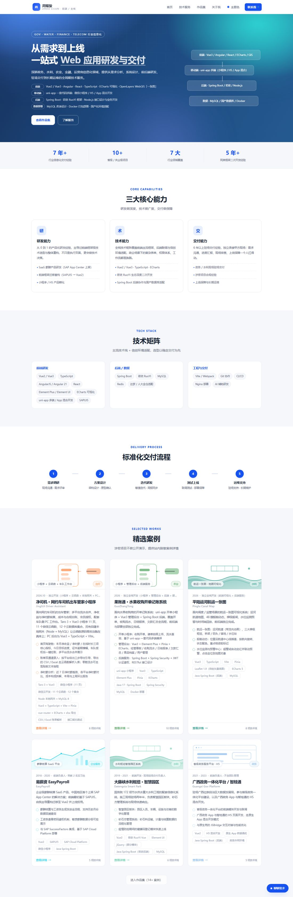

# 个人作品集（Vue 3 + TypeScript）

一个用来展示项目经历与作品的前端作品集站点：首屏动效、项目卡片、详情页、技术栈展示与在线咨询。

线上地址：https://zhoucijun-d2gete83h2f2bb329-1491685520.tcloudbaseapp.com/





## 技术栈

- Vue 3（Composition API）+ TypeScript + Vite
- Vue Router（history 模式）
- 无 UI 框架，组件与样式全部手写（含 SVG/CSS 自绘动效）

## 实现要点

1. **首屏动效**：星空背景（Canvas）与铜鼓纹样（SVG 路径动画）均为自绘，用 `requestAnimationFrame` 控制帧率，`prefers-reduced-motion` 下自动降级。
2. **滚动揭示**：`useReveal` 基于 IntersectionObserver 实现，避免 scroll 事件抖动。
3. **深浅色主题**：`useTheme` 通过 CSS 变量切换，首屏前注入避免闪白。
4. **作品详情**：截图用 `import.meta.glob` 自动收集 `src/assets/shots/<项目id>/` 下的图片，新增项目只放图、不改代码。
5. **类型化数据**：`src/data/portfolio.ts` 用 TS 类型约束项目结构，新增作品字段缺失会在 `vue-tsc` 阶段报错。

## 本地运行

```bash
npm install
npm run dev
npm run build      # vue-tsc --noEmit && vite build
```

## 关于截图

仓库内仅保留**自有产品**的界面截图（果账通、桂备菜、净司机、农田一张图）。此前任职期间参与的政务、水利、金融类项目受保密协议约束，其界面截图与业务细节**未包含在本仓库中**，项目中对应条目仅保留文字描述。

## 目录结构

```
src/
├── components/    # HeroSection、StarField、BronzeDrum、ProjectCard 等
├── composables/   # useTheme / useReveal / useDepth / useConsult
├── data/          # portfolio.ts 作品数据、shotLabels.ts
├── views/         # Home / Portfolio / ProjectDetail / ConsultAdmin
├── router/
└── styles/
```
